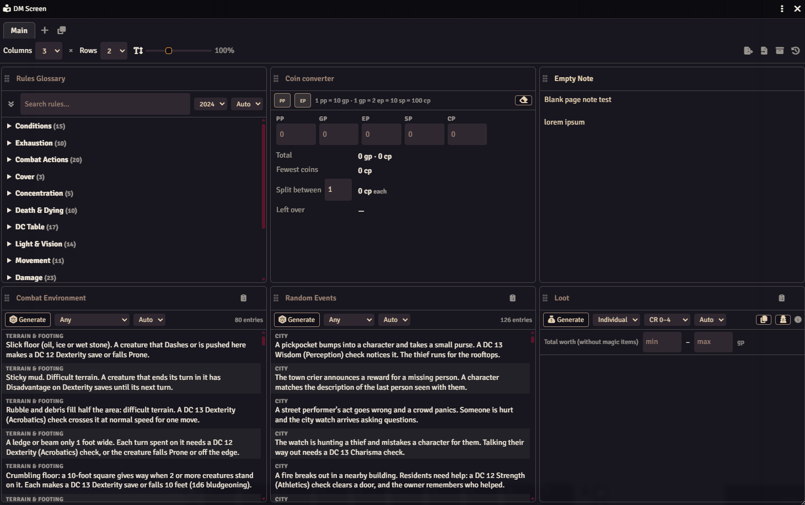
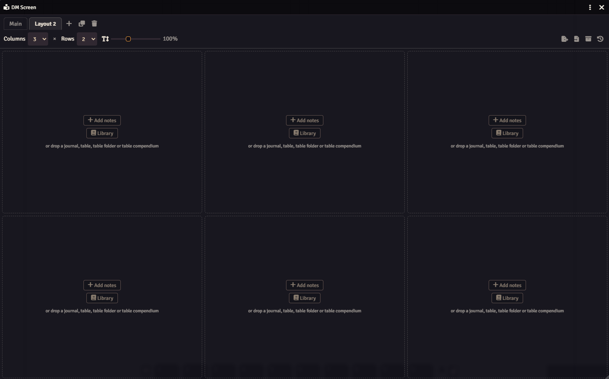

# Roll101 DM Screen

A configurable Game Master screen for Foundry VTT. Keep notes, rollable tables,
table-folder generators, journals and quick rules references in one grid window,
without leaving Foundry.

> **Status:** 1.1.0. Tested on Foundry v14; v13 untested. Back up your world before first use.
> See [docs/TESTING.md](docs/TESTING.md).

## Screenshots



Several layouts as tabs. Empty cells take notes, library boxes or dropped journals and tables.



## Features

- Grid layout you choose (up to 8 × 6), with adjustable window and text size.
  Boxes can be moved, swapped and resized over several cells.
- Box types: notes, journal, rollable table, table-folder generator, coin converter,
  reference templates (for example Services & Prices, 2014 and 2024, English and Turkish).
- Table-folder generator: browse or search a folder of rollable tables, generate one result
  or a whole folder at once, then reroll, copy or whisper it to the GM.
- Multiple layouts as tabs, with export and import as JSON and automatic local backups.
- Library with search and categories to add any box to an empty cell.
- Content packs: add your own reference tables. See [docs/content-packs.md](docs/content-packs.md).
- Visible to the Gamemaster only. Players and trusted players see nothing.

- Rules references summarized from SRD 5.2.1 (2024) and SRD 5.1 (2014), in English and Turkish:
  conditions, exhaustion, combat actions, cover, concentration, death and dying, DCs, light and vision,
  movement, damage, objects, traps, environmental hazards and weapon mastery, plus a searchable Rules Glossary.

- Generators (English and Turkish): Combat Environment (terrain, hazards, weather, magic, objects)
  and Random Events (city, village, town, wilderness, forest, snow, desert, general).
  Pick a category, press Generate, then reroll, copy or whisper the result to the GM.
- Party summary (D&D 5e): AC, HP, initiative, speed, passive scores, spell DC, inspiration and
  conditions of all player-owned characters, or of actors you drop in. Updates live.

- Loot Generator (English and Turkish): individual treasure or hoards for four CR tiers. Coins and
  items always add up to the same total value: gems, art objects, trade goods and equipment (names
  and prices from SRD 5.1), plus magic items in hoards. Amounts and gem/art descriptions are original.
- Party summary also shows dnd5e group actors (coins and members, read only). Toggle each section.

## Compatibility

| Foundry VTT | Status |
|---|---|
| v14 | Tested |
| v13 | Minimum supported, not tested yet. Reports welcome. |

System-agnostic. Some optional boxes (actor summary) need the dnd5e system.

## Installation

In Foundry: **Add-on Modules → Install Module**, then paste this manifest URL:

```
https://github.com/emirtopaloglu0/roll101-dm-screen/releases/latest/download/module.json
```

## Privacy note

The screen UI is GM-only, but Foundry sends world settings to every connected client.
Do not store secrets you would never want a technically skilled player to read.

## License

Open source. Code: [MIT](LICENSE).
Rules content: based on the System Reference Document 5.1 and 5.2.1 by Wizards of the Coast LLC,
licensed under [CC-BY-4.0](https://creativecommons.org/licenses/by/4.0/legalcode). See [NOTICE.md](NOTICE.md).
This project is not affiliated with Wizards of the Coast or Foundry Gaming LLC.

## Contributing and security

Pull requests are welcome: see [CONTRIBUTING.md](CONTRIBUTING.md).
To report a vulnerability, see [SECURITY.md](SECURITY.md).
